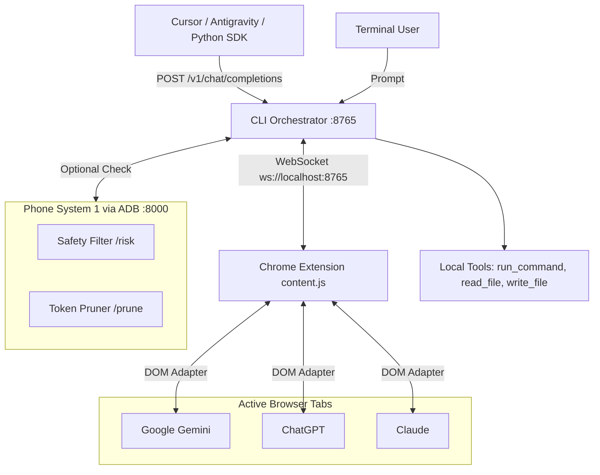

<div align="center">
  <h1>Gemini Bridge</h1>
  <p><strong>Universal Webchat Harness and OpenAI Proxy for Local Developer Agents</strong></p>
  <p>Developer: <strong>Bhoid</strong> (<a href="https://github.com/CoderBhoid">@CoderBhoid</a> · <a href="https://bhoid.sednium.com">bhoid.sednium.com</a>)</p>
  <p>
    <a href="https://github.com/CoderBhoid/gemini-bridge"></a>
    <a href="https://github.com/CoderBhoid/gemini-bridge/stargazers"></a>
    <a href="https://bhoid.sednium.com"></a>
    <a href="LICENSE"></a>
    <a href="mailto:bhoid@sednium.com"></a>
  </p>
</div>

---

Gemini Bridge connects local coding agents to active browser sessions on Google Gemini, ChatGPT, and Claude. It lets you use web interfaces directly from your terminal or IDE, executes local developer tools (`run_command`, `read_file`, `write_file`), and exposes a local OpenAI-compatible API on `http://localhost:8765/v1`.

You can also use your Android phone as a **Pocket Server running Laya for System 1 models**. Laya runs on-device via [Oorty](https://github.com/Sednium-Technologies/OORTY) ([APK releases](https://github.com/Sednium-Technologies/OORTY/releases)) or standalone Termux to handle fast-path gating, safety checks, and token reducing before prompts ever reach your cloud webchat session.

---

## 🛡️ Visible Browser Tab Mode (Recommended for Account Safety)

Running Gemini Bridge with a normal, visible Chrome tab is the **strongly recommended setup** for zero ban risk and complete peace of mind.

### Why visible tab mode protects your account
1. **Authentic browser session**: Uses your regular logged-in Google, OpenAI, or Anthropic account session with standard cookies and security tokens.
2. **Real hardware fingerprint**: Runs with your genuine graphics card driver, authentic Canvas rendering, WebGL context, audio stack, and genuine screen resolution.
3. **Legitimate extension runtime**: Executes as a standard Manifest V3 content script inside Chrome, indistinguishable from normal extension activity (like Grammarly or Vimium).
4. **Zero automation flags**: Avoids all `navigator.webdriver` flags, automated testing attributes, and headless browser markers that anti-bot services (Cloudflare, reCAPTCHA Enterprise, Arkose) look for.

### Why you should keep Chrome open
For maximum safety, keep Chrome running with your webchat tab open. You do not need to actively watch it—it can sit on a secondary monitor or in a background workspace while you code. Keeping the window alive ensures the browser maintains active render frames and authentic user presence.

### Built-in Human Safety Mode
Safety Mode is enabled by default across both the CLI orchestrator and Chrome extension:
- **Randomized paste jitter**: Waits a random delay between 1200ms and 2400ms before sending text to the chat input (never 0ms instant submissions).
- **Simulated pointer events**: Dispatches full `pointerdown`, `mousedown`, `pointerup`, `mouseup`, and `click` sequences with simulated client coordinates instead of raw programmatic clicks.
- **Reading pace pause**: Enforces a 1500ms human reading pace pause before sending subsequent automated tool prompts.
- **Token flood protection**: Restricts tool outputs in `tools.js` to 50 lines and 2000 characters so rolling token buckets do not exhaust.

---

## What It Does

- **Works with any model selected in the web app**: You choose the model in the UI (like **Argon**, **GPT-6.1 Sol**, **GPT-6 Astra**, **Fable 5.5 / 5.1**, or **Claude Opus 5.5**), and the bridge uses it dynamically.
- **Universal webchat support**: One Chrome extension works across `gemini.google.com`, `chatgpt.com`, and `claude.ai`.
- **OpenAI-compatible server**: Drop `http://localhost:8765/v1` into Cursor, Antigravity, OpenClaude, Continue.dev, or the Python OpenAI SDK.
- **Autonomous terminal loop**: Run commands and edits through the `gemini-bridge>` CLI with markdown tool blocks.
- **Local tool runner**: Executes shell commands, reads file slices, and writes files safely on your local disk with output limits.
- **Headless background daemon**: Run Chrome invisibly in RAM without an open browser window cluttering your desktop.
- **Android Pocket Server offload**: Turn your Android phone into a pocket server running Laya for fast-path System 1 token reduction and safety gating.

---

## Tech Stack

- **CLI Server**: Node.js HTTP and WebSocket (`ws`) server exposing `/v1/chat/completions` and `/v1/models`.
- **Browser Extension**: Manifest V3 content script running DOM adapters for Gemini, ChatGPT, and Claude.
- **Tool Engine**: Local child process runner and atomic file system utilities.
- **Phone Microservice**: Lightweight Node.js server running in Termux over ADB reverse.

---

## Architecture



---

## Quick Start

### 🤖 One-Click Setup Prompt for Coding Agents (Cursor / Antigravity / Claude Code)
If you use an AI coding assistant, paste this prompt into your agent to set up the safe, visible tab mode automatically:

> **Copy-paste this prompt into your AI agent:**
> ```text
> Help me set up Gemini Bridge with maximum account safety (Visible Chrome Tab Mode):
> 1. Clone https://github.com/CoderBhoid/gemini-bridge into my workspace and run `npm install`.
> 2. Start the bridge service with safety mode (`npm start` or `node cli.js --safe`) listening on port 8765.
> 3. Ask me which webchat interface I want to use (Google Gemini, ChatGPT, or Claude).
> 4. Instruct me to load the unpacked extension from `chrome-extension/` in Chrome, open my chosen webchat tab, and pick ANY model I prefer in that webchat. Emphasize that for 100% account safety, I should keep the Chrome window open (it can sit on a secondary monitor or background workspace).
> 5. Query `http://localhost:8765/v1/models` to dynamically detect the active model reported by my connected browser tab.
> 6. Configure this workspace / agent to use base URL `http://localhost:8765/v1` with that detected model (or `gemini-web`), send a test completion to verify, and confirm when ready.
> ```

---

### Manual Setup

### 1. Install Dependencies
```bash
git clone https://github.com/CoderBhoid/gemini-bridge.git
cd gemini-bridge
npm install
```

### 2. Choose How to Run the Browser

#### Method A: Visible Tab Mode (Strongly Recommended for Account Safety)
This is the default and safest method. It uses your real Chrome window with genuine session tokens and zero headless flags.
1. Open Google Chrome and go to `chrome://extensions/`.
2. Turn on **Developer mode** in the top right corner.
3. Click **Load unpacked** and select the `chrome-extension/` directory.
4. Open [Gemini](https://gemini.google.com), [ChatGPT](https://chatgpt.com), or [Claude](https://claude.ai) in a tab and select your preferred model.
5. Keep this Chrome window open while coding (you can move it to a secondary monitor or background desktop workspace).
6. The floating badge in the bottom-left will turn green: `Agent Bridge: Ready [Platform: Model | Safe Mode]`.

#### Method B: Headless Background Mode (Experimental / Higher Risk)
> ⚠️ **Warning**: Headless mode strips GPU contexts and sets automation indicators (`navigator.webdriver`) that can trigger CAPTCHAs, bot challenges, or account flags. For daily development on your personal account, use Method A (Visible Tab Mode) above.

If you understand the risks and want to run Chrome in the background without open windows:
1. Run one-time setup to log into your account:
   ```bash
   npm run headless:login
   # Or: ./launch-headless.sh --login https://gemini.google.com
   ```
2. Close the browser window once logged in.
3. Start the headless background daemon anytime:
   ```bash
   npm run headless
   ```
   Chrome will run silently in the background, attach to the bridge, and process agent prompts.

### 3. Connect Android Phone via Oorty (Pocket Server Laya Offload)
To prevent token exhaustion and stop webchat rate limits from dying early:
1. Download and install **[Oorty Mobile](https://github.com/Sednium-Technologies/OORTY/releases)** (APK available from the [Sednium-Technologies/OORTY](https://github.com/Sednium-Technologies/OORTY) repository) on your Android device. Oorty acts as an on-device model supervisor and pocket server.
2. Inside Oorty, enable the **Laya server** on port 8000.
   *(Alternatively, if you don't have the Oorty app, run the bundled script in Termux: `bash phone-bridge/termux_setup.sh`)*.
3. Connect your phone via USB and run:
   ```bash
   bash phone-bridge/adb_connect.sh
   ```
   This establishes a zero-latency reverse proxy on port 8000 (`localhost:8000`).
4. **System 1 Token Reducing**: Laya runs as a local on-device filter on your phone:
   - **Output Pruning (`/prune`)**: Automatically trims verbose build logs and repetitive terminal lines before they get sent to the webchat, preserving up to 90% of your input tokens.
   - **Destructive Command Risk Gate (`/risk`)**: Checks commands locally for dangerous shell operations before execution.
   *If the phone or Oorty is not running, Gemini Bridge gracefully bypasses offload with zero delay.*

### 4. Start the Agent Loop
```bash
npm start
```
Enter your goal at the `gemini-bridge>` prompt:
```
gemini-bridge> inspect package.json and add a test script
```

---

## Client Integration

Gemini Bridge exposes an OpenAI-compatible API at `http://localhost:8765/v1`.

### Cursor / Antigravity / Continue.dev
- **Base URL**: `http://localhost:8765/v1`
- **API Key**: Any placeholder (e.g. `sk-gemini-bridge`)
- **Model**: Any model active in your webchat tab (detected dynamically via `/v1/models`), or `gemini-web`

### Python OpenAI Client
```python
from openai import OpenAI

client = OpenAI(
    base_url="http://localhost:8765/v1",
    api_key="gemini-bridge"
)

response = client.chat.completions.create(
    model="argon",
    messages=[{"role": "user", "content": "Write a short bash script to check disk usage."}]
)
print(response.choices[0].message.content)
```

---

## Managing Token Limits and Quotas

If you notice message limits ending quickly during long agent runs:

1. **Understand Context Accumulation**: In webchat interfaces, each turn retains previous message history. A 10-turn conversation with large terminal outputs can send over 40,000 tokens on every turn.
2. **Reset Threads for New Tasks**: Open a fresh chat session for a new task rather than letting one thread grow indefinitely.
3. **Use Fast Models for Tool Execution**: Select lighter, fast models for repetitive terminal loops. Switch to **Argon**, **GPT-6.1 Sol**, or **Fable 5.5** when you need heavy architecture planning.
4. **Oorty Laya Offload**: Turning on the Laya server from Oorty on your phone automatically prunes verbose logs before they reach the webchat.

---

## API & Protocol Reference

### Endpoints

- `GET /v1/models`: Lists active browser models and standard aliases.
- `POST /v1/chat/completions`: Standard OpenAI completions endpoint (supports streaming SSE chunks and JSON).
- `WS ws://localhost:8765`: Bi-directional bridge socket used by the browser extension.

### WebSocket Messages

| Message | Origin | Purpose |
| :--- | :--- | :--- |
| `HELLO` | Browser → CLI | Reports active platform, model name, and URL on connection. |
| `STATUS` | Browser → CLI | Fires when you switch models in the web UI. |
| `PROMPT` | CLI → Browser | Injects prompt and triggers submission in the chat window. |
| `RESPONSE` | Browser → CLI | Returns completed response once the model finishes generating. |
| `ERROR` | Browser → CLI | Reports input element or network issues. |

---

## Support & Community

If Gemini Bridge helps your workflow or research, give the project a star on GitHub! It helps other developers find the project.

- **Star the Repo**: [GitHub Repository](https://github.com/CoderBhoid/gemini-bridge)
- **Report Bugs**: Open an issue on GitHub or email `bhoid@sednium.com`.
- **Contributions**: Pull requests for new webchat DOM adapters or tools are welcome.

---

## Authors & Credits

- **Developer**: **Bhoid** ([@CoderBhoid](https://github.com/CoderBhoid) · [bhoid.sednium.com](https://bhoid.sednium.com))
- **Contact & Support**: [bhoid@sednium.com](mailto:bhoid@sednium.com)

---

## Code of Conduct

This project is governed by the [Contributor Covenant](CODE_OF_CONDUCT.md), version 2.1. By participating, you agree to uphold this standard. Report any issues to [bhoid@sednium.com](mailto:bhoid@sednium.com).

---

## ⚠️ Disclaimer & Terms of Service

- **Educational & Research Use**: Gemini Bridge is an independent developer experiment exploring browser DOM adapters and local agent workflows. It is provided strictly for educational and personal testing purposes.
- **Third-Party Terms of Service**: Automating web chat interfaces may violate or conflict with the Terms of Service of Google (Gemini), OpenAI (ChatGPT), or Anthropic (Claude), which typically require using their official developer APIs for programmatic access. Using automation on web accounts carries inherent risks, including rate limits, CAPTCHA challenges, or account restrictions.
- **No Affiliation**: This project is not affiliated, endorsed, sponsored, or supported by Google, OpenAI, Anthropic, or any of their subsidiaries. All trademarks, service marks, and brand names belong to their respective owners.
- **Limitation of Liability**: This tool is provided "as is" without warranty of any kind. The author(s) and contributor(s) are not responsible or liable for any account actions, bans, service disruptions, or ToS violations resulting from the use of this project. You use this software entirely at your own discretion and risk.

---

## License

This project is licensed under the MIT License. See [LICENSE](LICENSE) for the full license text.

Copyright (c) 2026 **Bhoid (CoderBhoid)**.
