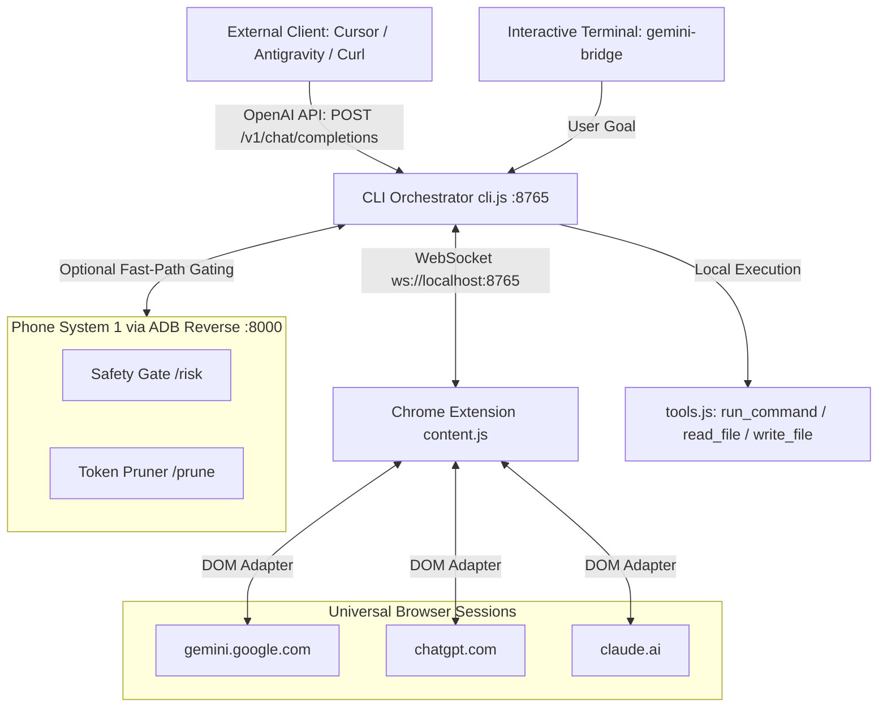

# Gemini Bridge

**Gemini Bridge** is a high-performance, model-agnostic webchat orchestrator and OpenAI-compatible proxy that connects local agentic workflows directly to active browser sessions on Google Gemini, ChatGPT, and Claude. It features automated DOM interaction, local developer tool execution (`run_command`, `read_file`, `write_file`), and optional Android Phone System 1 offload for token pruning and command safety verification.

---

## Key Features

- **Universal Multi-Platform Support**: Works out of the box with `gemini.google.com`, `chatgpt.com` / `chat.openai.com`, and `claude.ai`.
- **Dynamic Model Tracking**: Automatically detects the active model selected in the web interface (Gemini 2.0 Flash, Claude 3.7 Sonnet, GPT-4o, etc.) and exposes it dynamically via `/v1/models`.
- **OpenAI-Compatible Proxy**: Drop-in replacement endpoint at `http://localhost:8765/v1/chat/completions` supporting both SSE streaming and non-streaming responses for Cursor, Antigravity, OpenClaude, and custom agent SDKs.
- **Autonomous Agentic Loop**: Interactive CLI prompt (`gemini-bridge>`) supporting local tool calls formatted in clean markdown blocks.
- **Local Developer Tool Suite**: Built-in, safety-bounded implementations of `run_command`, `read_file`, and `write_file` with automated output truncation.
- **Phone System 1 Offload**: Integrates with an Android phone running Termux over low-latency ADB reverse (`localhost:8000`) to evaluate command risk (`/risk`) and prune verbose outputs (`/prune`), gracefully bypassing if disconnected.
- **Visual Status Overlay**: Floating, non-intrusive bottom-left badge inside the web browser displaying connection state and active model in real time.

---

## Tech Stack

| Component | Technology | Description |
| :--- | :--- | :--- |
| **CLI & Proxy** | Node.js, `http`, `readline` | Orchestrator, CLI loop, and OpenAI proxy |
| **Communication** | `ws` (WebSocket) | Full-duplex messaging between CLI and Browser |
| **Extension** | Chrome Manifest V3 | DOM automation and response observation |
| **Mobile Offload** | Android Termux, ADB | System 1 fast-gating and token pruning |

---

## Architecture Overview



### Request Lifecycle
1. The client sends a request to the interactive CLI or the `/v1/chat/completions` proxy.
2. The orchestrator formats the conversation history and available tool specifications into a unified prompt.
3. The prompt is transmitted over WebSocket (`ws://localhost:8765`) to `content.js` in Chrome.
4. The content script injects the prompt into the active platform's input element, triggers submission, and monitors DOM mutations until completion.
5. The extracted response is returned via WebSocket.
6. If the response contains a tool call (e.g. `run_command`):
   - Safety check is queried from Phone System 1 (`/risk`).
   - The tool executes locally.
   - Result is pruned (`/prune`) and fed back into the next loop turn.
7. If final answer is reached, it is streamed back to the client.

---

## Prerequisites

- **Node.js**: v18.0.0 or higher.
- **Google Chrome** (or Chromium-based browser: Brave, Edge, Vivaldi).
- **Android Phone** (Optional, for System 1 offload): Termux and USB debugging enabled.

---

## Getting Started

### 1. Installation
```bash
cd "/run/media/bhoid/StorageVault/WEbs/Gemini Bridge"
npm install
```

### 2. Load Chrome Extension
1. Open Google Chrome and go to `chrome://extensions/`.
2. Enable **Developer mode** (toggle in upper right).
3. Click **Load unpacked** and select the `chrome-extension/` directory.
4. Open your preferred webchat:
   - [Google Gemini](https://gemini.google.com)
   - [ChatGPT](https://chatgpt.com)
   - [Claude](https://claude.ai)
5. Look for the floating badge in the bottom-left corner (`Agent Bridge: Ready [Platform: Model]`).

### 3. Connect Android Phone (Optional)
1. In Android Termux:
   ```bash
   pkg update && pkg install nodejs-lts git
   node phone-bridge/phone_laya_server.js
   ```
2. On your laptop, connect phone via USB and run:
   ```bash
   bash phone-bridge/adb_connect.sh
   ```
   *If the phone is not connected, Gemini Bridge operates normally without delays.*

### 4. Launch the CLI Orchestrator
```bash
npm start
```
Type any objective at the `gemini-bridge>` prompt.

---

## API Reference

### OpenAI-Compatible HTTP Proxy

#### `GET /v1/models`
Returns currently attached browser session model and standard model aliases.
```bash
curl http://localhost:8765/v1/models
```

#### `POST /v1/chat/completions`
Send standard OpenAI chat payloads. Supports any model name and streaming (`"stream": true`).
```bash
curl http://localhost:8765/v1/chat/completions \
  -H "Content-Type: application/json" \
  -d '{
    "model": "gemini-web",
    "messages": [
      {"role": "user", "content": "List the files in the current directory using run_command."}
    ],
    "stream": false
  }'
```

### WebSocket Protocol Messages (`ws://localhost:8765`)

| Direction | Message Type | Payload Structure | Description |
| :--- | :--- | :--- | :--- |
| **Browser → CLI** | `HELLO` | `{ "type": "HELLO", "platform": string, "model": string, "url": string }` | Sent immediately on connection |
| **Browser → CLI** | `STATUS` | `{ "type": "STATUS", "platform": string, "model": string }` | Sent when active model changes |
| **CLI → Browser** | `PROMPT` | `{ "type": "PROMPT", "text": string }` | Sends prompt for webchat injection |
| **Browser → CLI** | `RESPONSE` | `{ "type": "RESPONSE", "text": string }` | Returns completed assistant response |
| **Browser → CLI** | `ERROR` | `{ "type": "ERROR", "message": string }` | Sent if DOM injection or observation fails |

---

## CLI Options & Flags

```bash
node cli.js --help      # Show full CLI manual
node cli.js --test      # Verify syntax and environment readiness
node cli.js --port 9000 # Listen on custom port (also respects PORT env var)
```

---

## Troubleshooting Guide

| Issue | Cause | Solution |
| :--- | :--- | :--- |
| `Agent Bridge: Disconnected` badge | `cli.js` is not running or port 8765 is blocked | Start `npm start` and verify port 8765 is open. |
| `503 Browser extension not connected` | No supported webchat tab is open | Open `gemini.google.com`, `chatgpt.com`, or `claude.ai` in Chrome. |
| Tool execution permission errors | Commands require elevated privileges | Run safe local commands or check directory permissions. |
| Phone System 1 not detected | ADB reverse port not forwarded | Re-run `bash phone-bridge/adb_connect.sh` and accept USB prompt on phone. |
| Claude ProseMirror input not registering | Claude DOM structure updated | Extension simulates keyboard `input` and `change` events. Ensure tab has focus. |

---

## License

MIT
```

---
