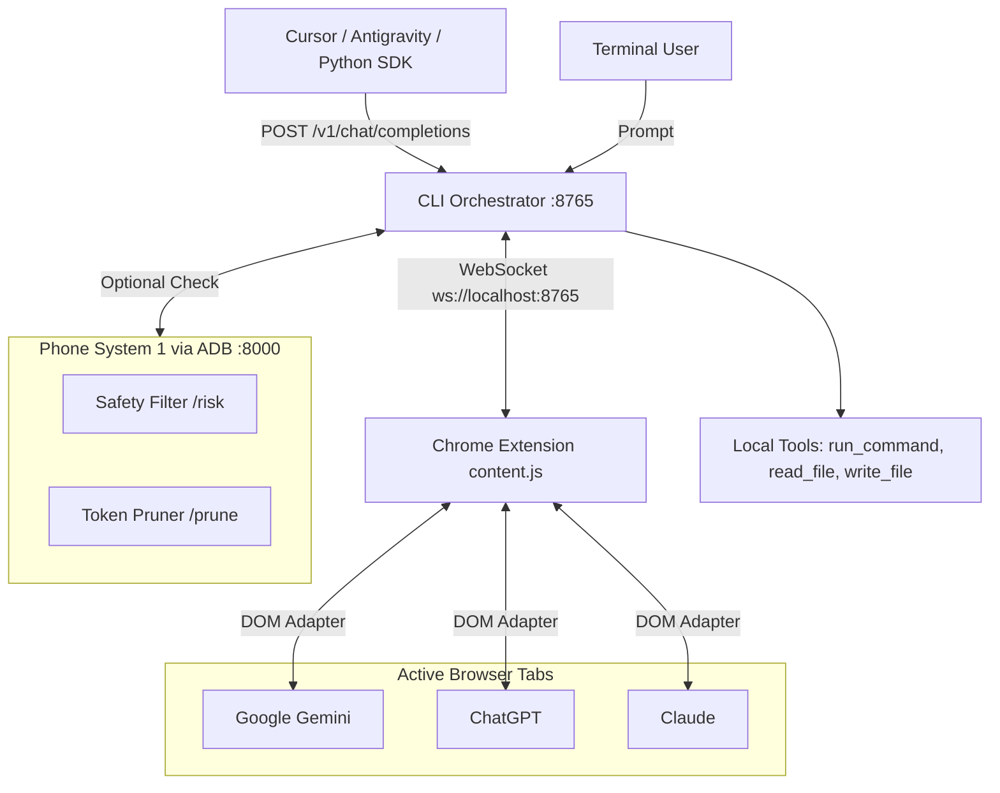

<div align="center">
  <h1>Gemini Bridge</h1>
  <p><strong>Universal Webchat Harness and OpenAI Proxy for Local Developer Agents</strong></p>
  <p>Developer: <strong>bhoid</strong> (<a href="https://github.com/CoderBhoid">@CoderBhoid</a>)</p>
  <p>
    <a href="https://github.com/CoderBhoid/gemini-bridge"></a>
    <a href="https://github.com/CoderBhoid/gemini-bridge/stargazers"></a>
    <a href="LICENSE"></a>
    <a href="mailto:officialbhoid@gmail.com"></a>
  </p>
</div>

---

Gemini Bridge connects local coding agents to active browser sessions on Google Gemini, ChatGPT, and Claude. It lets you use web interfaces directly from your terminal or IDE, executes local developer tools (`run_command`, `read_file`, `write_file`), and exposes a local OpenAI-compatible API on `http://localhost:8765/v1`.

If you have an Android phone, you can also offload token pruning and destructive command checks to a local Termux microservice over ADB reverse.

---

## What It Does

- **Works with any model selected in the web app**: You choose the model in the UI (Gemini 2.0 Flash, Gemini Advanced, Gemini 1.5 Pro, Claude 3.7 Sonnet, GPT-4o), and the bridge uses it dynamically.
- **Universal webchat support**: One Chrome extension works across `gemini.google.com`, `chatgpt.com`, and `claude.ai`.
- **OpenAI-compatible server**: Drop `http://localhost:8765/v1` into Cursor, Antigravity, OpenClaude, Continue.dev, or the Python OpenAI SDK.
- **Autonomous terminal loop**: Run commands and edits through the `gemini-bridge>` CLI with markdown tool blocks.
- **Local tool runner**: Executes shell commands, reads file slices, and writes files safely on your local disk with output limits.
- **Headless background daemon**: Run Chrome invisibly in RAM without an open browser window cluttering your desktop.
- **Android Phone offload**: Connect an Android phone via USB to run token pruning and command safety checks in Termux.

---

## Tech Stack

- **CLI Server**: Node.js HTTP and WebSocket (`ws`) server exposing `/v1/chat/completions` and `/v1/models`.
- **Browser Extension**: Manifest V3 content script running DOM adapters for Gemini, ChatGPT, and Claude.
- **Tool Engine**: Local child process runner and atomic file system utilities.
- **Phone Microservice**: Lightweight Node.js server running in Termux over ADB reverse.

---

## Architecture



---

## Quick Start

### 1. Install Dependencies
```bash
git clone https://github.com/CoderBhoid/gemini-bridge.git
cd gemini-bridge
npm install
```

### 2. Choose How to Run the Browser

#### Method A: Normal Browser Mode (Visible Tab)
1. Open Google Chrome and go to `chrome://extensions/`.
2. Turn on **Developer mode** in the top right.
3. Click **Load unpacked** and select the `chrome-extension/` directory.
4. Open [Gemini](https://gemini.google.com), [ChatGPT](https://chatgpt.com), or [Claude](https://claude.ai).
5. A floating badge will appear in the bottom-left corner showing your active model and connection status.

#### Method B: Headless Background Mode (No Open Windows)
If you want to keep your desktop clean without browser windows open:
1. Run one-time setup to log into your account:
   ```bash
   npm run headless:login
   # Or: ./launch-headless.sh --login https://gemini.google.com
   ```
2. Close the browser window once logged in.
3. Start the headless background daemon anytime:
   ```bash
   npm run headless
   ```
   Chrome will run silently in the background, attach to the bridge, and process agent prompts.

### 3. Connect Android Phone (Optional)
If you want to offload token pruning and command safety checks to your phone:
1. In Android Termux:
   ```bash
   pkg update && pkg install nodejs-lts git
   node phone-bridge/phone_laya_server.js
   ```
2. Connect your phone via USB and run:
   ```bash
   bash phone-bridge/adb_connect.sh
   ```
   *If the phone is not connected, the bridge skips offload and runs normally.*

### 4. Start the Agent Loop
```bash
npm start
```
Enter your goal at the `gemini-bridge>` prompt:
```
gemini-bridge> inspect package.json and add a test script
```

---

## Client Integration

Gemini Bridge exposes an OpenAI-compatible API at `http://localhost:8765/v1`.

### Cursor / Antigravity / Continue.dev
- **Base URL**: `http://localhost:8765/v1`
- **API Key**: Any placeholder (e.g. `sk-gemini-bridge`)
- **Model**: `gemini-web`, `gemini-2.0-flash`, `claude-3-7-sonnet`, `gpt-4o`

### Python OpenAI Client
```python
from openai import OpenAI

client = OpenAI(
    base_url="http://localhost:8765/v1",
    api_key="gemini-bridge"
)

response = client.chat.completions.create(
    model="gemini-web",
    messages=[{"role": "user", "content": "Write a short bash script to check disk usage."}]
)
print(response.choices[0].message.content)
```

---

## Managing Token Limits and Quotas

If you notice message limits ending quickly during long agent runs:

1. **Understand Context Accumulation**: In webchat interfaces, each turn retains previous message history. A 10-turn conversation with large terminal outputs can send over 40,000 tokens on every turn.
2. **Reset Threads for New Tasks**: Open a fresh chat session for a new task rather than letting one thread grow indefinitely.
3. **Use Flash for Tool Execution**: Switch your webchat dropdown to **Gemini 2.0 Flash** for mechanical coding loops (`npm test`, `git status`). Use **Gemini Advanced / Argon** when you need heavy architecture planning.
4. **Phone Pruning**: Running `phone-bridge/phone_laya_server.js` automatically trims verbose logs to keep prompts compact.

---

## API & Protocol Reference

### Endpoints

- `GET /v1/models`: Lists active browser models and standard aliases.
- `POST /v1/chat/completions`: Standard OpenAI completions endpoint (supports streaming SSE chunks and JSON).
- `WS ws://localhost:8765`: Bi-directional bridge socket used by the browser extension.

### WebSocket Messages

| Message | Origin | Purpose |
| :--- | :--- | :--- |
| `HELLO` | Browser → CLI | Reports active platform, model name, and URL on connection. |
| `STATUS` | Browser → CLI | Fires when you switch models in the web UI. |
| `PROMPT` | CLI → Browser | Injects prompt and triggers submission in the chat window. |
| `RESPONSE` | Browser → CLI | Returns completed response once the model finishes generating. |
| `ERROR` | Browser → CLI | Reports input element or network issues. |

---

## Support & Community

If Gemini Bridge helps your workflow or saves you API bills, give the project a star on GitHub! It helps other developers find the tool.

- **Star the Repo**: [GitHub Repository](https://github.com/CoderBhoid/gemini-bridge)
- **Report Bugs**: Open an issue on GitHub or email `officialbhoid@gmail.com`.
- **Contributions**: Pull requests for new webchat DOM adapters or tools are welcome.

---

## Authors & Credits

- **Developer**: **bhoid** ([@CoderBhoid](https://github.com/CoderBhoid))
- **Contact & Support**: [officialbhoid@gmail.com](mailto:officialbhoid@gmail.com)

---

## Code of Conduct

This project is governed by the [Contributor Covenant](CODE_OF_CONDUCT.md), version 2.1. By participating, you agree to uphold this standard. Report any issues to [officialbhoid@gmail.com](mailto:officialbhoid@gmail.com).

---

## License

This project is licensed under the MIT License. See [LICENSE](LICENSE) for the full license text.

Copyright (c) 2026 **bhoid (CoderBhoid)**.
